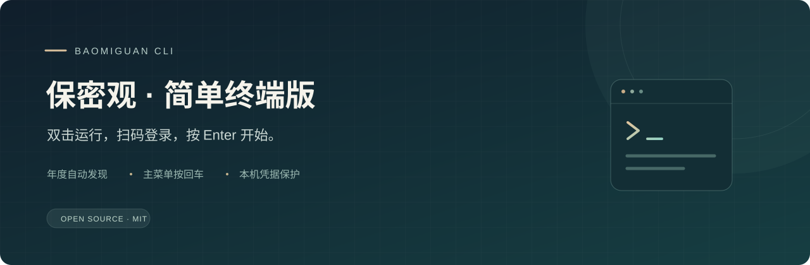
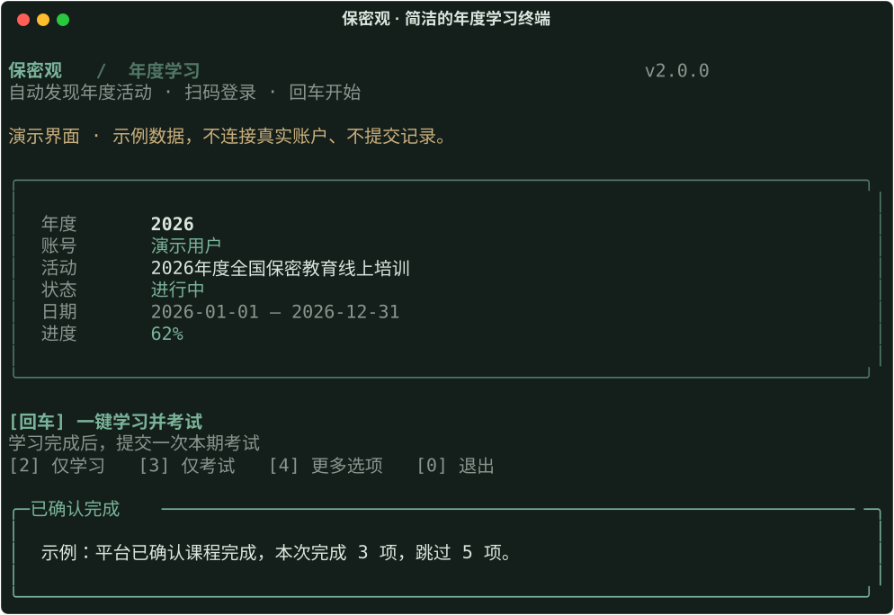

<div align="center">



[](https://github.com/knightHuo/baomiguan-cli/releases/latest)
[](pyproject.toml)
[](LICENSE)

[下载 Windows 版](https://github.com/knightHuo/baomiguan-cli/releases/latest) · [快速开始](#快速开始) · [年度更新](#年度与软件更新) · [反馈问题](https://github.com/knightHuo/baomiguan-cli/issues)

</div>

一个窗口，完成保密观年度活动的登录、学习和考试操作。基于 [AutoBaoMiGuan](https://github.com/NB-XX/AutoBaoMiGuan) 改进，使用清晰的终端菜单，无需配置文件。



## 快速开始

1. 在 [Releases](https://github.com/knightHuo/baomiguan-cli/releases/latest) 下载 `Baomiguan.exe`，双击运行。
2. 程序自动查找本年度活动；主菜单直接按 **Enter**，再按提示用保密观 App 扫码登录。
3. 登录后继续执行“学习后考试”。窗口显示当前进度与结果，结束后关闭即可；下次会自动恢复登录。

菜单还提供账号密码登录、仅学习、仅考试、切换年度与检查软件更新。活动需要选择时，按窗口提示操作。

| 操作 | 使用方式 |
| --- | --- |
| 日常使用 | 双击程序，扫码登录，主菜单按 Enter |
| 查看进度 | 终端中显示当前活动、任务状态与处理结果 |
| 切换年度 | 通过菜单重新读取并选择活动，不修改代码或配置 |
| 停止操作 | 按 Ctrl+C 停止后续处理，当前请求会等待结果；已经提交的记录以平台状态为准 |

## 年度与软件更新

**年度活动动态读取。** 启动时从保密观平台读取活动信息，优先发现本年度活动，依据平台返回的时间展示状态。不写死年度与活动 ID。平台接口和数据保持兼容时，跨年无需重新修改这些值；尚未开始、已经结束或状态不明的活动不会直接启动任务。

**平台接口变化需要适配。** 登录、字段或业务规则发生变化时，仍需更新代码并发布新版。动态发现活动不能保证未来每一年的接口始终兼容。

**新版本经过校验再保存。** 菜单可检查本项目 GitHub Releases，下载 `Baomiguan.exe`。只接受 `knightHuo/baomiguan-cli` 的发行附件，优先使用 GitHub SHA-256 digest，否则读取同一发行的 `SHA256SUMS`；缺少校验或校验失败时拒绝保存。下载位置为本机应用数据目录的 `Baomiguan/updates`。下载后关闭旧版，启动新文件即可，不自动覆盖正在运行的程序。

## 凭据与使用边界

- 账号密码只用于本次登录。登录成功后，会话凭据保存到 Windows 凭据管理器；不可用或在其他系统运行时只保留在内存中，不回退到明文文件。
- 不自动导入旧版 `credentials.json`，请重新登录。注销会清除本工具保存的会话。
- 已有历史成绩时，默认不重新考试；本次会话中已提交或结果待确认时，不重复提交。成绩待确认请前往官网核对。
- 请使用自己的授权账户，按所在单位与平台要求完成学习和考试。学习、考试和证书结果以平台实际记录为准。
- 仓库测试和演示截图验证程序逻辑与终端表现，不代表已为任意真实账户完成年度学习、考试或证书验收。

## 源码运行

需要 Python 3.11 或更新版本。Windows PowerShell 示例：

```powershell
git clone https://github.com/knightHuo/baomiguan-cli.git
cd baomiguan-cli
python -m venv .venv
.\.venv\Scripts\python -m pip install -e ".[dev]"
.\.venv\Scripts\python main.py
```

源代码也可在其他终端系统中运行，独立发行程序当前面向 Windows。

## 开发与发布

```powershell
.\.venv\Scripts\python -m ruff check .
.\.venv\Scripts\python -m pytest -q
.\.venv\Scripts\python scripts/build.py
```

Windows 构建生成 `dist/Baomiguan.exe` 与 `dist/SHA256SUMS`。GitHub Actions 在 Windows / Linux 运行检查；推送与代码版本一致的 `v*` 标签后构建并上传发行附件。手动运行发布工作流只生成构建产物。

## 来源与许可

本项目基于 [NB-XX/AutoBaoMiGuan](https://github.com/NB-XX/AutoBaoMiGuan)（MIT）公开的保密观接口实现进行改进，保留原作者版权声明，新增终端菜单、动态活动发现、系统凭据存储与校验下载等实现。

MIT © 2025 NB-XX · © 2026 XingYuan Huo。详见 [LICENSE](LICENSE) 与 [第三方说明](THIRD_PARTY_NOTICES.md)。本项目为独立开源工具，与保密观平台无隶属关系。
